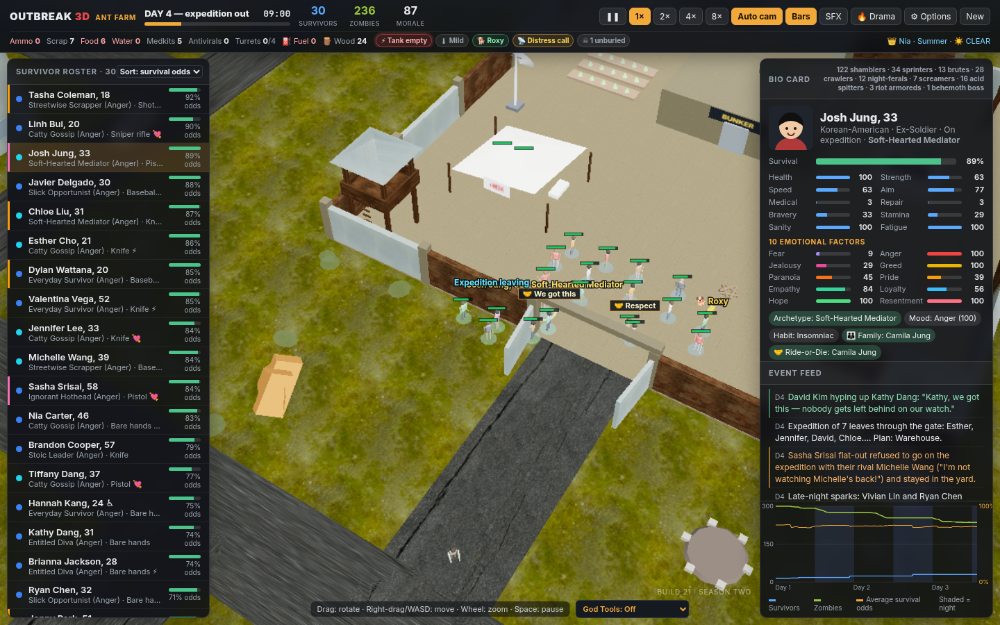
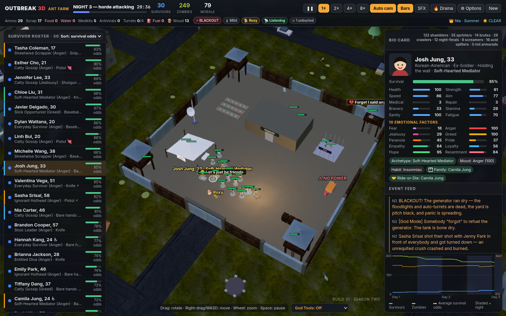

# Outbreak 3D ("Ant Farm" Season Two) — Autonomous Human-Zombie Colony & Social Drama Simulation Game



**Outbreak 3D** is a seeded, fixed-step, fully autonomous **human-zombie "ant-farm" survival simulation game** that runs identically in the browser (rendered in 3D with Three.js + 2D HUD telemetry) and headlessly in Node.js (`tools/test_outbreak.js`). Instead of micromanaging units with direct movement orders, you watch—or poke with **God Tools**—as 30 distinct survivors live, scavenge, fall in love, form cliques, feud, mutiny on expeditions, and defend a fortified compound against escalating waves of 9 specialized zombie classes.



## Key Simulation Systems

1. **10 Dynamic Emotional Factors (`0–100`) per Survivor (`static/ob_sim.js`):**
   - Every survivor continuously updates **Fear, Anger, Jealousy, Greed, Paranoia, Pride, Empathy, Loyalty, Hope, and Resentment** in response to battles, rations, blackouts, deaths, romances, and betrayals.
   - Emotional states directly govern combat accuracy, movement speed, resource hoarding, friendly cooperation, and brawl/sabotage triggers.
2. **12 Personality Archetypes & Emergent Social Drama:**
   - Survivors spawn with distinct archetypes—*Stoic Leader, Catty Gossip, Streetwise Scrapper, Ignorant Hothead, Saboteur, Soft-Hearted Mediator, Ride-or-Die, Entitled Diva, Paranoid Prepper, Instigator, Empath,* and *Slick Opportunist*.
   - **Pairwise Relationship Graph (`-100` to `+100`):** Tracks **Romances, Ride-or-Die Best Friends, Named Cliques, Rivals, Feuds, and Exes**. Survivors confess crushes, get rejected in front of the yard, spark love triangles, break up, refuse to go on scavenging expeditions with rivals, or brawl in the compound.
3. **Season Two Colony Infrastructure & Survival Hazards:**
   - **Generator & Fuel Blackouts:** When fuel runs dry at night, floodlights and auto-turrets shut down (`BLACKOUT`), plunging the yard into darkness and spiking colony panic.
   - **Camp Guard Dog (`Roxy`):** Patrols the yard, barks early warnings on approaching hordes, boosts survivor morale, and intercepts breaches.
   - **Four Seasons & Weather:** Dynamic temperature and weather shifts (*Summer heat exhaustion, Winter hypothermia*, wood-burning stove heat, rain, and fog).
   - **Radio Dish & Distress Calls:** Survivors repair the dish to intercept outside supply drops or survivor distress beacons.
   - **Medical Triage, Emergency Amputations & Corpse Disposal:** Bitten limbs can be amputated in the med-tent to prevent turning; unburied corpses spread sickness across the compound.
4. **9 Zombie Classes & Solid AABB / Circle Collision Physics:**
   - *Shamblers, Sprinters, Brutes, Crawlers, Night-Ferals, Screamers, Acid Spitters, Riot Armored,* and *Behemoth Bosses*.
   - Full AABB + circle collision prevents humans and zombies from phasing through buildings, intact compound walls, the inner bunker, wrecked vehicles, or trees.
5. **Interactive Drama Ledger, Bio Inspector & God Tools:**
   - Inspect any survivor's live portrait, 10 emotional bars, family/clique ties, and survival odds, or open the **Drama Modal** (*Love, Breakups, Confessions, Beefs, Cliques, Relationship Web*) and trigger **God Tools** (blackouts, horde surges, supply drops, or forced drama).

## Quick Start

```bash
./run.sh
# Opens on http://localhost:8112
```

## Headless CLI & Balance Verification Suite

```bash
node tools/test_outbreak.js
node tools/diag.js
node tools/balance.js
```
